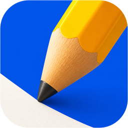
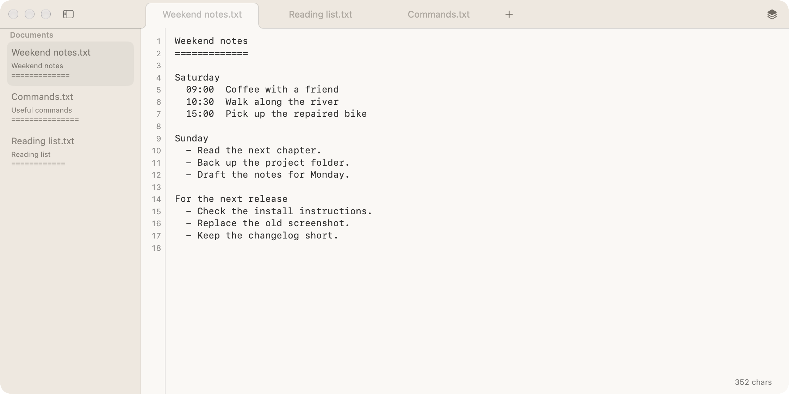

# NeatEditor

<p align="center">
  
</p>

[](https://developer.apple.com/macos/)
[](./LICENSE)

> macOS ネイティブのプレーンテキストエディタ。

**言語:** [English](./README.md) | [简体中文](./README.zh-CN.md) | [日本語](./README.ja.md) | [한국어](./README.ko.md) | [Español](./README.es.md) | [Français](./README.fr.md) | [Deutsch](./README.de.md)

## スクリーンショット

<p align="center">
  
</p>

## インストール

**macOS 26.0+ · Apple silicon / Intel 対応。** macOS 専用です。Linux / Windows 版はありません。

```bash
brew install --cask x0c/tap/neateditor
```

または[署名・公証済みの最新 DMG](https://github.com/NeatMacApps/NeatEditor/releases/latest)を開き、`NeatEditor.app` を `Applications` にドラッグしてください。

起動後は `Command + O` でファイルを開くか、`Command + N` で新しい文書を作成できます。

## NeatEditor の用途

メモ、下書き、テキストファイルのちょっとした編集に。

## 主な特徴

- **タブ：** 切り替え、クローズ、その場での名前変更、直前に閉じたタブの再表示。
- **ローカルファイル：** Finder、ドラッグ＆ドロップ、ファイル URL の貼り付けで開けます。保存済み文書の名前変更はディスク上の名前にも反映します。
- **ネイティブ編集：** 行番号、検索、Undo、IME 変換入力、`Command +/-` による文字ズーム。
- **自動保存：** 入力停止から 2 秒後、タブ切り替え時、アプリ非アクティブ時に順番に保存。
- **外部の変更：** 別のエディタ、スクリプト、コーディングエージェントによる変更を扱えます。未編集のバッファは再読み込みし、独立した変更は慎重にマージ、検出した競合は両方の版を保持します。
- **空白の保護：** 空または空白のみの内容は既存ファイルを上書きしません。編集欄を空にしてもディスク上のファイルは空になりません。
- **文書フォルダ：** 初期値は `~/Documents`。Settings → Editor → Documents Folder で変更できます。新規文書は選択したフォルダに保存します。
- **見やすい位置に：** ウインドウの最前面固定と、使い慣れたネイティブのメニュー・タイトルバー操作。

他のプログラムもファイルを変更できるため、重要な内容は別にバックアップしてください。

## 主なショートカット

| ショートカット | 動作 |
| --- | --- |
| `Command + N` | 新しいドキュメントを作成します。 |
| `Command + T` | 新しいタブを追加で開きます。 |
| `Command + O` | 1 つ以上のローカルテキストファイルを開きます。 |
| `Command + S` | 現在のタブをすぐに保存します。 |
| `Command + W` | 現在のタブを保存して閉じます。 |
| `Shift + Command + T` | 直前に閉じたタブを再度開きます。 |
| `Command + F` | 現在のエディタでインライン検索バーを表示します。 |
| `Command + =` または `Command + +` | エディタ文字を拡大します。 |
| `Command + -` | エディタ文字を縮小します。 |
| `Command + ,` | 設定を開きます。 |
| `Shift + Return` | 現在の行末に移動して改行を挿入します。 |

<details>
<summary>ソースからビルド（Xcode）</summary>

macOS 26.0+、Xcode 26.0+、[XcodeGen](https://github.com/yonaskolb/XcodeGen) 2.44+ が必要です。

```bash
git clone https://github.com/NeatMacApps/NeatEditor.git
cd NeatEditor
xcodegen generate
open NeatEditor.xcodeproj
```

```bash
xcodebuild -project "NeatEditor.xcodeproj" \
  -scheme "NeatEditor" \
  -configuration Debug \
  -destination 'platform=macOS' \
  -derivedDataPath build/DerivedData \
  build
```

テストと開発については [CONTRIBUTING.md](CONTRIBUTING.md) を参照してください。

</details>

## ドキュメント

- [開発とテスト](CONTRIBUTING.md)
- [リリース履歴](CHANGELOG.md)

Issue、提案、Pull Request を歓迎します。

## ライセンス

NeatEditor は [MIT License](LICENSE) の下で公開されています。

## 関連ツール

| ツール | 説明 |
|---|---|
| [NeatPaste](https://github.com/NeatMacApps/NeatPaste) | メニューバーの macOS クリップボード履歴。 |
| [NeatWebApp](https://github.com/NeatMacApps/NeatWebApp) | Web サイトを独立した macOS アプリにし、ノッチランチャーから起動。 |
| [HandySwitch](https://github.com/x0c/HandySwitch) | メニューバーからダークモード切り替えとスリープ防止。 |
| [MacResourceMonitor](https://github.com/x0c/MacResourceMonitor) | メニューバーから CPU を多く使うプロセスを確認。 |
| [Corral](https://github.com/corral-dev/corral) | ターミナルでコーディングエージェントのセッションを管理し、Mac や iPhone から継続。 |
