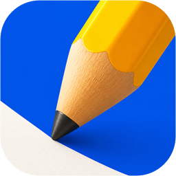

# NeatEditor

<p align="center">
  
</p>

[](https://developer.apple.com/macos/)
[](./LICENSE)

> A native plain-text editor for macOS. Open it and start writing.

**Languages:** [English](./README.md) | [Simplified Chinese](./README.zh-CN.md) | [Japanese](./README.ja.md) | [Korean](./README.ko.md) | [Spanish](./README.es.md) | [French](./README.fr.md) | [German](./README.de.md)

## Screenshot

<p align="center">
  
</p>

## Install

**macOS 26.0+ · Apple silicon and Intel.** macOS only; no Linux or Windows build.

```bash
brew install --cask x0c/tap/neateditor
```

Or [download the latest signed and notarized DMG](https://github.com/NeatMacApps/NeatEditor/releases/latest), open it, and drag `NeatEditor.app` to `Applications`.

After launching, use `Command + O` to open a file or `Command + N` for a new document.

## Why NeatEditor

For notes, drafts, and quick edits that don't need a full IDE.

## Highlights

- **Tabs:** switch, close, rename in place, and reopen the last closed tab.
- **Local files:** open through Finder, drag and drop, or pasted file URLs; renaming a saved document also renames its disk file.
- **Native editing:** line numbers, find, undo, input-method composition, and `Command +/-` text zoom.
- **Autosave:** after a 2-second pause, on tab switches, and when the app becomes inactive. Saves run in order.
- **External edits:** handle changes made by another editor, script, or coding agent. Unmodified buffers reload; independent edits merge conservatively; detected conflicts retain both versions.
- **Blank-content protection:** empty or whitespace-only text does not overwrite an existing file. Clearing the editor therefore does not empty its disk file.
- **Your documents folder:** defaults to `~/Documents`; change it in Settings → Editor → Documents Folder. New documents save to the selected folder.
- **Keep it in view:** pin the window above others; use familiar native menus and title-bar behavior.

Other programs can still change the file, so keep backups of important work.

## Main Shortcuts

| Shortcut | Action |
| --- | --- |
| `Command + N` | Create a new document. |
| `Command + T` | Open another new tab. |
| `Command + O` | Open one or more local text files. |
| `Command + S` | Save the current tab immediately. |
| `Command + W` | Save and close the current tab. |
| `Shift + Command + T` | Reopen the most recently closed tab. |
| `Command + F` | Show the inline find bar for the current editor. |
| `Command + =` or `Command + +` | Zoom in the editor text. |
| `Command + -` | Zoom out the editor text. |
| `Command + ,` | Open Settings. |
| `Shift + Return` | Insert a new line at the end of the current line. |

<details>
<summary>Build from source (Xcode)</summary>

Requires macOS 26.0+, Xcode 26.0+, and [XcodeGen](https://github.com/yonaskolb/XcodeGen) 2.44+.

```bash
git clone https://github.com/NeatMacApps/NeatEditor.git
cd NeatEditor
xcodegen generate
open NeatEditor.xcodeproj
```

```bash
xcodebuild -project "NeatEditor.xcodeproj" \
  -scheme "NeatEditor" \
  -configuration Debug \
  -destination 'platform=macOS' \
  -derivedDataPath build/DerivedData \
  build
```

For tests and development, see [CONTRIBUTING.md](CONTRIBUTING.md).

</details>

## Documentation

- [Contributing and tests](CONTRIBUTING.md)
- [Release history](CHANGELOG.md)

Issues, suggestions, and pull requests are welcome.

## License

NeatEditor is released under the [MIT License](LICENSE).

## Related Tools

| Tool | Description |
|---|---|
| [NeatPaste](https://github.com/NeatMacApps/NeatPaste) | macOS clipboard history in the menu bar. |
| [NeatWebApp](https://github.com/NeatMacApps/NeatWebApp) | Turn websites into focused macOS apps with a notch launcher. |
| [HandySwitch](https://github.com/x0c/HandySwitch) | Toggle dark mode and prevent sleep from the menu bar. |
| [MacResourceMonitor](https://github.com/x0c/MacResourceMonitor) | Find CPU-hungry processes from the menu bar. |
| [Corral](https://github.com/corral-dev/corral) | Manage coding-agent sessions in the terminal and continue from Mac or iPhone. |
